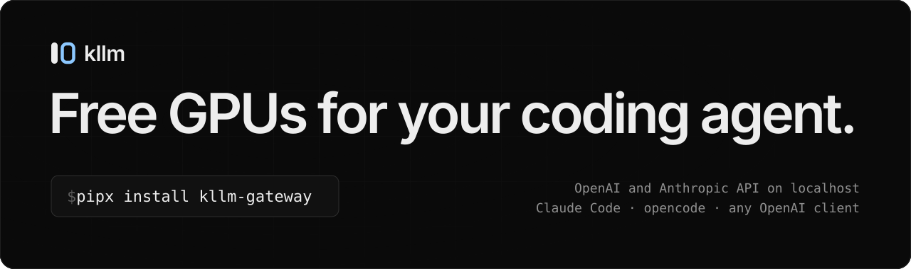
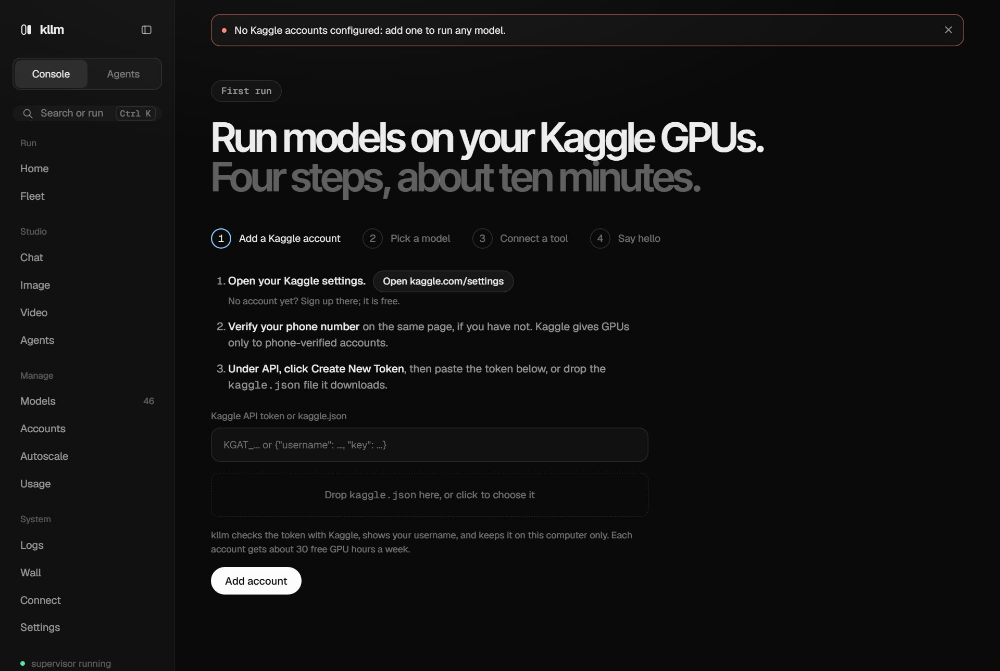
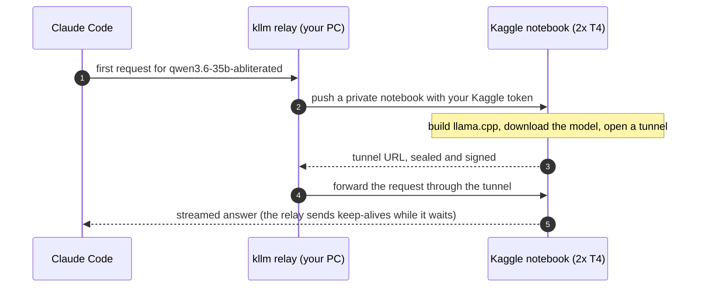
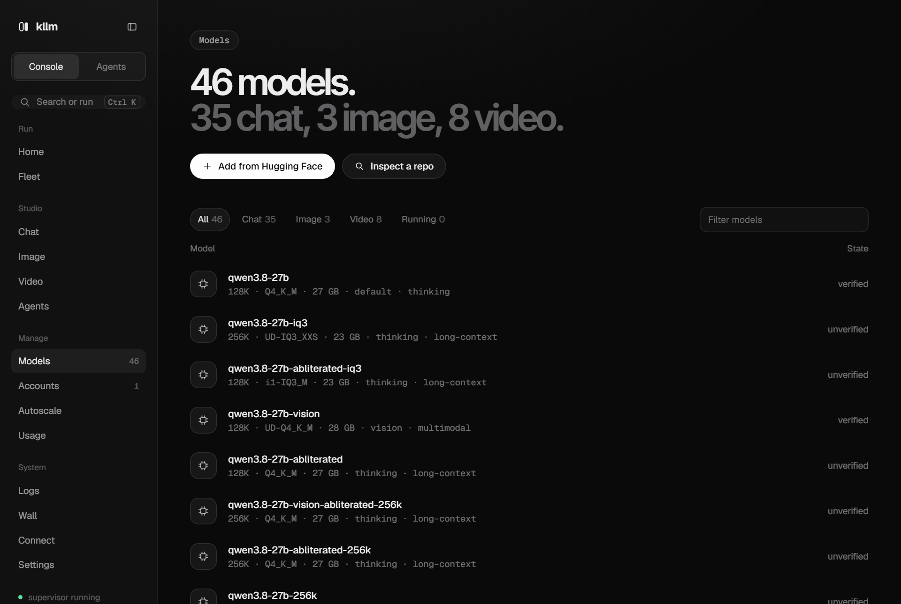

<p align="center">
  
</p>

<p align="center">
  <a href="https://github.com/SANTHAN-KUMAR/kllm/actions/workflows/tests.yml"></a>
  <a href="https://pypi.org/project/kllm-gateway/"></a>
  
  
  <a href="LICENSE"></a>
</p>

**kllm runs open-weight LLMs on Kaggle's free GPUs and gives your coding tools a local API for them.**

Your laptop has no GPU. You still want Claude Code to refactor a 2,000-line module on a 35B model, with a
256K context window, without paying per token. With kllm you install one package, paste a Kaggle token once,
and run `claude-kllm`. Ten minutes later the model is answering from two Tesla T4s in a Kaggle notebook, and
Claude Code talks to it as if it were running on `127.0.0.1`.

That raises a few questions, answered below:

- [How do I get started?](#how-do-i-get-started)
- [What happens when I run it?](#what-happens-when-i-run-it)
- [Which models can I run, and how fast are they?](#which-models-can-i-run-and-how-fast-are-they)
- [How do I connect Claude Code, opencode or my own code?](#how-do-i-connect-claude-code-opencode-or-my-own-code)
- [What happens when Kaggle's 12-hour limit hits?](#what-happens-when-kaggles-12-hour-limit-hits)
- [Is my code and my Kaggle token safe?](#is-my-code-and-my-kaggle-token-safe)

## How do I get started?

<p align="center">
  
</p>

**1. Install** with one command. The one-line installers bring their own Python through [uv](https://docs.astral.sh/uv/).

| You have | Run |
| --- | --- |
| Nothing (Linux, macOS) | `curl -fsSL https://raw.githubusercontent.com/SANTHAN-KUMAR/kllm/main/install.sh \| sh` |
| Nothing (Windows) | `powershell -ExecutionPolicy ByPass -c "irm https://raw.githubusercontent.com/SANTHAN-KUMAR/kllm/main/install.ps1 \| iex"` |
| uv | `uv tool install kllm-gateway` |
| pipx | `pipx install kllm-gateway` |
| pip | `pip install kllm-gateway` |

The package is `kllm-gateway` on PyPI. It installs two commands: `kllm` and `claude-kllm`.

**2. Run `kllm`.** It starts the local relay and opens the control panel in your browser. On a first run the
panel shows a four-step setup: add your Kaggle account, pick a model, connect a tool, say hello.

<p align="center">
  
</p>
<p align="center"><sub>First run: the panel links to your Kaggle settings and takes the token as a paste or a dropped <code>kaggle.json</code>. No file to edit.</sub></p>

You need a Kaggle account with a verified phone number, because Kaggle only gives GPUs to verified accounts.
If `~/.kaggle/kaggle.json` already exists, kllm finds it and skips the paste.

**3. Use it.**

```bash
claude-kllm                                  # Claude Code on the default model
opencode -m kllm/qwen3.6-35b-abliterated     # opencode
kllm down                                    # stop the GPU when you are done, to save quota
```

The first request starts a GPU if none is running. Expect about 8 to 10 minutes for a cold start, while
Kaggle boots the notebook and downloads the model. The request waits and then continues on its own.

## What happens when I run it?

Your tools never talk to Kaggle. They talk to a small relay on your PC (one Python process, about 55 MB of
RAM), and the relay does the Kaggle work.


<p align="center"><sub>The relay holds the first request while the GPU starts, so the tool needs no retry logic.</sub></p>

After that, every request goes straight from the relay through the tunnel. The relay keeps each
conversation on the same GPU so the prompt cache stays warm: in measured sessions, 99% of each turn's
prompt came from the cache at 55K tokens of context. Details are in [How kllm works](docs/how-it-works.md).

## Which models can I run, and how fast are they?

Two models are measured end to end on two T4s. The panel lists 46 models in all, and adds any GGUF or
diffusers repo from Hugging Face.

| Model | Best for | Context | Measured speed |
| --- | --- | --- | --- |
| `qwen3.6-35b-abliterated` (default) | Long agent sessions; thinks before answering | 256K | 70 tok/s short, 43 tok/s at 209K |
| `qwen3-coder-30b-abliterated` | Fastest turnaround, no thinking | 96K | 84 tok/s short, 35 tok/s at 84K |

<p align="center">
  
</p>
<p align="center"><sub>The model library shows what fits two T4s before you launch anything.</sub></p>

Image and video models (SDXL Turbo, LTX-Video, Wan 2.1) run in the same notebook behind the OpenAI Images
API. Anything above 30 GB of VRAM does not fit. See [Models](docs/models.md) for adding models and calling
image and video endpoints.

## How do I connect Claude Code, opencode or my own code?

The relay speaks both the OpenAI and the Anthropic API at `http://127.0.0.1:8080`. Requests from your own
machine need no key.

| Tool | How |
| --- | --- |
| Claude Code | `claude-kllm`, which sets the model and the real context window for you |
| opencode, Codex CLI, Gemini CLI, Antigravity, Cursor | the panel's **Connect** page writes their config and keeps a backup for Undo |
| Any OpenAI client | base URL `http://127.0.0.1:8080/v1`, model `kllm` (whatever is running) |
| Any Anthropic client | `ANTHROPIC_BASE_URL=http://127.0.0.1:8080` |

From your own code it is a normal chat call:

```python
from openai import OpenAI

client = OpenAI(base_url="http://127.0.0.1:8080/v1", api_key="local")
reply = client.chat.completions.create(
    model="kllm",
    messages=[{"role": "user", "content": "Write a SQL query for the 5 newest orders."}],
)
print(reply.choices[0].message.content)
```

Other devices on your network, or a public URL, can use the same API with the gateway key shown in the
panel's Settings. See [Configuration](docs/configuration.md).

## What happens when Kaggle's 12-hour limit hits?

A Kaggle notebook stops after 12 hours. kllm plans for it: 25 minutes before the limit it starts a
successor, replays each conversation's latest prompt there so the cache is warm, and only then moves the
conversation.

```mermaid
gantt
    title One long Claude Code session across two Kaggle notebooks
    dateFormat HH:mm
    axisFormat %H:%M
    section Notebook A
    serving requests          :a1, 00:00, 11h
    section Notebook B
    starting (8 to 10 min)    :b0, 10:35, 10m
    warm handoff              :crit, b1, 10:45, 5m
    serving requests          :b2, 10:50, 6h
```


<p align="center"><sub>The successor is ready before the old notebook stops, so the session never sees the 12-hour cap.</sub></p>

The same handoff runs when a notebook dies early. In a 72-minute test with three agent sessions in parallel,
contexts grew to 165K tokens and generation held at 50 to 63 tok/s from empty to 175K
([full results](docs/how-it-works.md#how-well-does-it-hold-up-in-a-long-agent-session)).

Each Kaggle account gets about 30 GPU hours a week. `kllm down` stops the GPU, and an idle GPU stops by itself
after 25 minutes without requests.

## Is my code and my Kaggle token safe?

- **Your Kaggle token stays on your PC**, in your user folder. kllm uses it only to call Kaggle's API from your
  machine; it is never put into the notebook or sent anywhere else.
- **Your prompts go only to your notebook**, through a tunnel protected by a per-notebook API key.
- **The notebook's address is sealed.** The notebook reports its tunnel URL through [ntfy.sh](https://ntfy.sh),
  encrypted and signed with a secret generated on your PC, so nobody can read it or swap in a fake URL.
- **The panel is local only.** Requests from other machines need the gateway key and can reach only the model API.

kllm uses your Kaggle account and its free quota. Follow [Kaggle's Terms of Service](https://www.kaggle.com/terms),
which allow one account per person. kllm can manage several accounts (for example a team where each person adds
their own), but which accounts you add is your responsibility.

## What does not work yet?

- The first launch of a model on an account downloads about 20 GB, so it takes 8 to 10 minutes. Kaggle's GPU
  queue occasionally adds more.
- Models above about 28 GB of weights plus cache do not fit two T4s. A 230B model such as MiniMax-M2 cannot run.
- The bundled image and video entries are marked unverified: they were sized and checked, but not run on a GPU.
- Qwen3.6 sometimes thinks at length on trivial requests. That costs seconds, not quality.

## Back to that refactor

Claude Code is working through the 2,000-line module. It started on Notebook A at 09:00, the relay moved it
to Notebook B at 19:45 with its cache warm, and it is still answering at 43 tok/s with 200K tokens of
context. Nothing ran on your laptop but a 55 MB relay.

## More

| Read | For |
| --- | --- |
| [How kllm works](docs/how-it-works.md) | speed tuning, loop guard, tunnel keep-alive, GPU scheduling, the long-session test |
| [Models](docs/models.md) | choosing a model, adding one from Hugging Face, image and video endpoints |
| [Configuration](docs/configuration.md) | every tool's setup, remote access, gateway key, file layout |
| [Contributing](#contributing) | running the tests |

### Contributing

Issues and pull requests are welcome. Run the tests with `pip install -e ".[dev]"` and `python -m pytest`.
They never contact Kaggle, GitHub or ntfy, and never touch your home directory.

© 2026 SANTHAN-KUMAR. Released under the [MIT license](LICENSE).
