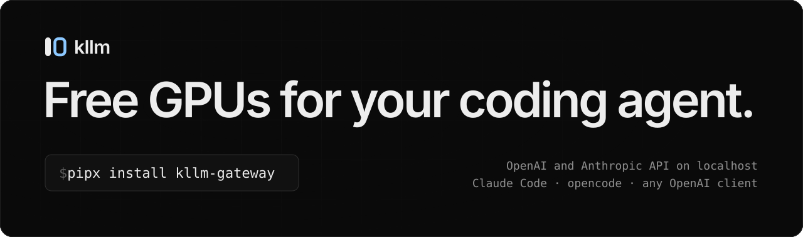
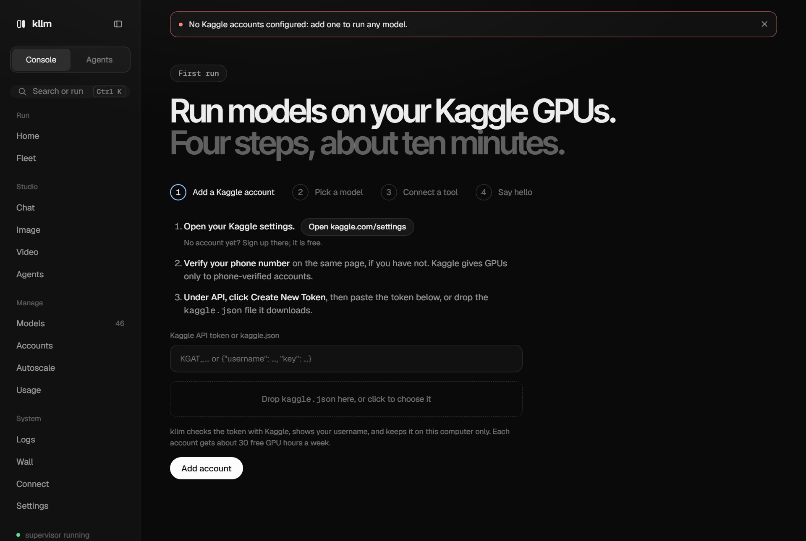

# kllm: free GPU LLMs for Claude Code, opencode and any OpenAI client



**kllm runs open-weight LLMs on Kaggle's free GPUs and gives your coding tools a local API for them.** It serves
Qwen and other GGUF models (including abliterated ones) through llama.cpp on two free Tesla T4s, behind an OpenAI
and Anthropic compatible endpoint on `127.0.0.1`. No local GPU, no API bill.

| 15,481 requests | 98.95% succeeded | 750M prompt tokens | 89.8% from cache | 395K largest context |
| --- | --- | --- | --- | --- |

<sub>Six weeks of one developer's Claude Code and opencode sessions (Oct 6 to Nov 16 2026), from kllm's request log.</sub>

## Install and run

```bash
pipx install kllm-gateway      # or: uv tool install kllm-gateway, or: pip install kllm-gateway
kllm                           # opens the panel; paste your Kaggle token once
claude-kllm                    # Claude Code on a 35B model in Kaggle
```

The package is `kllm-gateway`; it installs the `kllm` and `claude-kllm` commands. You need a Kaggle account with
a verified phone number (Kaggle's rule for GPU access). The first request starts a GPU in about 8 to 10 minutes;
after that, requests go straight through.



## Models measured on two T4s

| Model | Best for | Context | Speed |
| --- | --- | --- | --- |
| `qwen3.8-27b` family | Highest answer quality; vision variant | 128K or 256K | 16 to 19 tok/s over 6,889 real requests |
| `qwen3.6-35b-abliterated` (default) | Long agent sessions at speed | 256K | 70 tok/s short, 43 tok/s at 209K |
| `qwen3-coder-30b-abliterated` | Fastest turnaround | 96K | 84 tok/s short |

## Use it from any tool

| Tool | How |
| --- | --- |
| Claude Code | `claude-kllm` |
| opencode, Codex CLI, Gemini CLI, Antigravity, Cursor | the panel's Connect page writes their config |
| OpenAI clients | base URL `http://127.0.0.1:8080/v1`, model `kllm` |
| Anthropic clients | `ANTHROPIC_BASE_URL=http://127.0.0.1:8080` |

When a Kaggle notebook nears its 12-hour limit, kllm starts a successor and moves each conversation with its
prompt cache warm, so long sessions continue. Idle GPUs stop by themselves to save your weekly quota.

## Links

- Documentation, diagrams and source: [github.com/SANTHAN-KUMAR/kllm](https://github.com/SANTHAN-KUMAR/kllm)
- Changelog: [CHANGELOG.md](https://github.com/SANTHAN-KUMAR/kllm/blob/main/CHANGELOG.md)
- Issues and questions: [Issues](https://github.com/SANTHAN-KUMAR/kllm/issues) and [Discussions](https://github.com/SANTHAN-KUMAR/kllm/discussions)

Use your own Kaggle account and follow [Kaggle's Terms of Service](https://www.kaggle.com/terms). MIT licensed.
