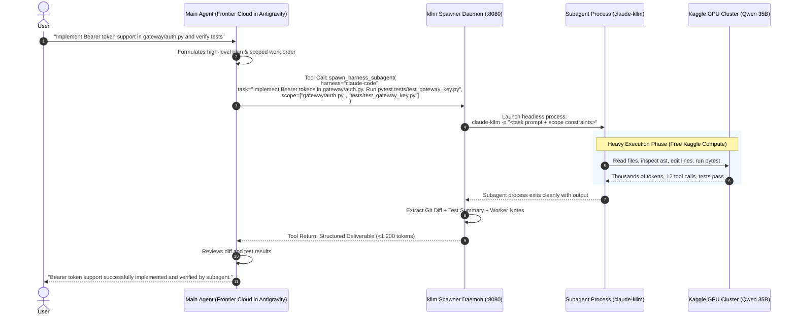

# Architecture Specification: Cross-Harness Subagent Spawning (CHSS)
## Orchestrating Kaggle GPU Workers as Harness-Level Subagents

---

## 1. The Core Vision

```
┌──────────────────────────────────────────────────────────────────────────────┐
│                    MAIN AGENT (Frontier Cloud LLM)                           │
│  "The Master Architect / Tech Lead" (Gemini 2.5/3.8 Pro, Claude 3.7 Sonnet)  │
│  • Dispatches plans, breaks down features, reviews code diffs                │
│  • Token frugal: only sees high-level strategy and compact deliverable diffs │
└───────────────────────┬──────────────────────────────┬───────────────────────┘
                        │                              │
         spawn_subagent(harness="claude-code")         │ spawn_subagent(harness="opencode")
                        ▼                              ▼
┌───────────────────────────────────────┐      ┌───────────────────────────────┐
│     SUBAGENT 1: Claude Code Harness   │      │   SUBAGENT 2: OpenCode Harness│
│  • CLI process: `claude-kllm -p ...`  │      │   • CLI process: `opencode...`│
│  • Native Claude Code tools (Bash,    │      │   • OpenCode native tools     │
│    Edit, Read, Glob, Grep)            │      │                               │
│  • Free Compute: Kaggle 2xT4 GPUs     │      │   • Free Compute: Kaggle GPUs │
│    via http://127.0.0.1:8080          │      │     via 127.0.0.1:8080        │
└───────────────────────────────────────┘      └───────────────────────────────┘
```

Instead of trying to force disparate harnesses to speak a fragile live wire protocol, **the Frontier Cloud LLM acts as a Main Agent that literally spawns and controls subagents inside target harnesses** (`claude-kllm`, `opencode`, `agy`), where each subagent is powered entirely by the **free Kaggle GPU cluster** (`qwen3.6-35b` or Swarm).

---

## 2. Why This Pattern Solves Every Problem

1. **Leverages Each Harness's Built-In Superpowers**:
   - **Claude Code** has battle-tested terminal execution, file editing, and autonomous loop engines.
   - **Antigravity (AGY)** has rich IDE workspace tools, browser automation, and sidecars.
   - **OpenCode** has lightweight terminal integrations.
   - Rather than reinventing these tools, the Main Agent reuses the entire harness as an isolated worker container.
2. **Kaggle GPUs Do 100% of the Heavy Lifting**:
   - The subagent process is spawned with `ANTHROPIC_BASE_URL=http://127.0.0.1:8080` (pointing to KLLM).
   - Reading 40 files, grepping across directories, making 15 code edits, and running test suites repeatedly consumes **0 cloud tokens**. All inferences run on Kaggle's free dual T4 GPUs.
3. **Massive Token & Cost Protection for the Cloud Model**:
   - The Main Agent never sees the 50,000 raw tokens of intermediate bash logs, terminal noise, or full file contents.
   - The subagent returns only a **Structured Deliverable Packet** (< 1,200 tokens):
     - Execution Status (`SUCCESS` / `BLOCKED` / `NEEDS_REVIEW`).
     - Compact unified Git Diff.
     - Test run summary.
     - Concise worker notes.
4. **Natural Resilience Against Smaller Model Drift**:
   - If the Kaggle model goes off track, it is confined to the subagent's scoped task.
   - The Main Agent reviews the resulting diff before any changes are committed or merged, catching hallucinations immediately.
5. **Strict Account Constraints for All Subagents**:
   - Subagents must strictly adhere to the user's explicit directive: **Use ONLY Kaggle accounts with the "kg" naming convention (`kg1`, `kg2`, ..., `kg22`).**
   - Subagents must **NEVER** touch, launch, or use any `lk*` or `kx*` accounts under any circumstances for operations or kernel launches.
   - **DO NOT delete or purge any accounts from config.yaml**: All accounts in `config.yaml` must remain permanently intact. The spawner embeds this mandatory policy in every subagent's execution lease prompt.

---

## 3. Subagent Lifecycle & Execution Flow



---

## 4. Subagent Spawner Architecture (`gateway/spawner.py`)

The spawner daemon runs inside `kllm serve` and exposes a universal API and MCP tool interface:

### 1. The Harness Adapter Interface
```python
class BaseHarnessDriver:
    async def spawn(self, task: str, scope: list[str], timeout: int) -> SubagentResult:
        """Launches the subagent process, streams telemetry, and collects deliverables."""
        raise NotImplementedError

class ClaudeCodeDriver(BaseHarnessDriver):
    async def spawn(self, task: str, scope: list[str], timeout: int) -> SubagentResult:
        cmd = [
            "claude-kllm",
            "-p", task,
            "--permission-mode=bypassPermissions",
        ]
        # Runs process with ANTHROPIC_BASE_URL=http://127.0.0.1:8080
        # Captures exit code, stdout, and git diff delta
```

### 2. The Universal Tool Definition (Exposed to the Main Agent)
Any Main Agent (in Antigravity, Claude Desktop, Cursor, or scripts) receives the tool:

```json
{
  "name": "spawn_harness_subagent",
  "description": "Spawns a specialized worker subagent inside a chosen harness (Claude Code, OpenCode, etc.) powered by free Kaggle GPUs to execute code edits and tests.",
  "parameters": {
    "type": "object",
    "properties": {
      "harness": {
        "type": "string",
        "enum": ["claude-code", "opencode", "agy"],
        "description": "Which harness environment to run the subagent in"
      },
      "task_instructions": {
        "type": "string",
        "description": "Clear, detailed task instructions for the subagent"
      },
      "permitted_files": {
        "type": "array",
        "items": {"type": "string"},
        "description": "Allowed files the subagent may edit"
      },
      "verification_command": {
        "type": "string",
        "description": "Command the subagent must run to verify success (e.g. pytest tests/...)"
      }
    },
    "required": ["harness", "task_instructions"]
  }
}
```

---

## 5. Structured Deliverable Return Contract

When the subagent completes, the spawner parses git status, test logs, and the subagent's stdout, returning a compact JSON packet back to the Main Agent:

```json
{
  "subagent_id": "subagent-claude-8492",
  "harness": "claude-code",
  "status": "COMPLETED",
  "execution_time_seconds": 42.5,
  "kaggle_tokens_consumed": 18450,
  "cloud_tokens_consumed": 0,
  "files_modified": ["gateway/auth.py", "tests/test_gateway_key.py"],
  "git_diff": "--- a/gateway/auth.py\n+++ b/gateway/auth.py\n@@ -30,6 +30,12 @@\n+    if auth.startswith('Bearer '):\n+        return auth[7:] == key",
  "verification_output": "================ 8 passed in 0.42s ================",
  "subagent_summary": "Added Bearer token parsing in verify_token. Updated test suite to verify both Bearer and raw header formats. All tests pass."
}
```

---

## 6. Implementation Roadmap

1. **`gateway/spawner.py`**:
   - Harness drivers for `claude-code` (`bin/claude-kllm -p ...`), `opencode`, and shell subagents.
   - Git delta & test output extractor.
2. **`gateway/mcp_server.py`**:
   - Expose `spawn_harness_subagent` and `list_subagents` over local MCP (`http://127.0.0.1:8080/mcp`).
   - Register the MCP server in Antigravity's `mcp_config.json` and Claude's config so any Main Agent can call it natively.
3. **Admin Panel View (`/admin`)**:
   - Subagent Fleet Monitor: view live running subagent sessions, their active harness, duration, diffs, and Kaggle GPU usage.
